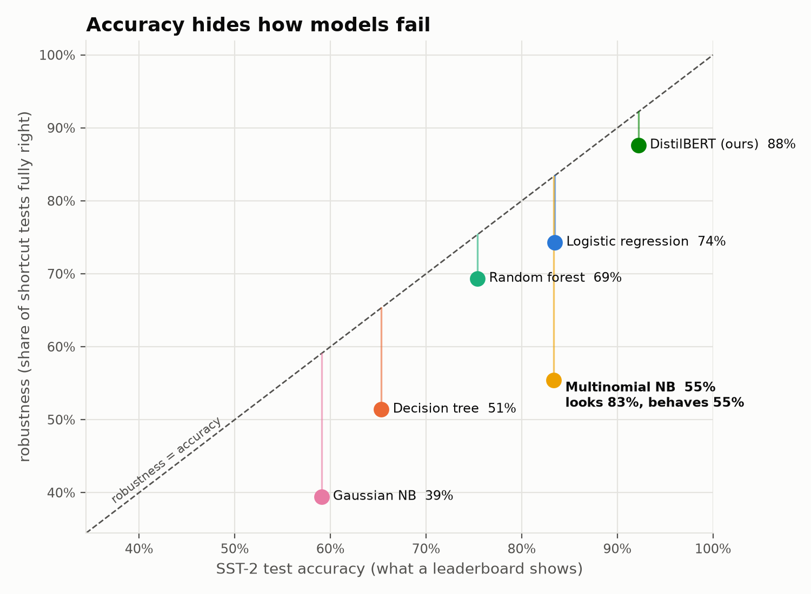
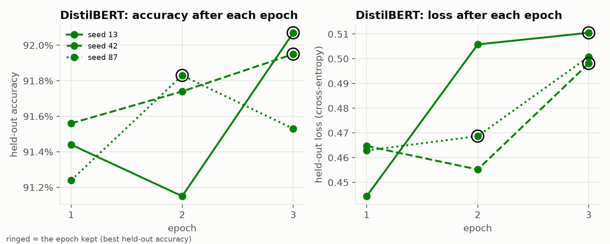

# Mirage: Exposing the Illusion of Accuracy

Detecting shortcut learning in sentiment classifiers — logistic regression, decision tree, random
forest, Multinomial and Gaussian Naive Bayes and DistilBERT — with behavioral tests, negation
marking, explanations and a Gaussian early-warning score on IMDb. Two ready-made models
(RoBERTa-large and Hugging Face's SST-2 DistilBERT) test whether scale cures shortcuts, and a live
demo shows the shortcuts sentence by sentence.

> **Status:** every experiment has run on the real data: classical models locally, DistilBERT and
> the two external models on Kaggle. The numbers below are final.

## Results

**The results in full, with every number and confidence interval, are in two files:**
- [hypothesisanswers.md](docs/results/hypothesisanswers.md): H1–H6, each with its test, tables, verdict, reasons
  and caveats;
- [interestingfindings.md](docs/results/interestingfindings.md): 15 further findings, each tied to the
  hypothesis it explains or extends.

The report draft, written around the Mirage Gap for the presentation, is
[docs/report/report.md](docs/report/report.md).

This section is the short version. Base variants; DistilBERT is the mean of 3 seeds; all
tables are in `results/` and all figures in `figures/`.

| model | SST-2 test | real negated sentences (519) | IMDb (10,000) | robustness (D40) |
|---|---|---|---|---|
| **DistilBERT** | **0.922** | **0.897** | **0.896** | **0.876** |
| Logistic regression | 0.835 | 0.773 | 0.795 | 0.743 |
| Multinomial NB | 0.834 | 0.761 | 0.760 | 0.554 |
| Random forest | 0.754 | 0.726 | 0.703 | 0.694 |
| Decision tree | 0.653 | 0.607 | 0.612 | 0.514 |
| Gaussian NB | 0.591 | 0.522 | 0.546 | 0.395 |
| *DistilBERT (Hugging Face), external* | *0.923* | *0.892* | *0.893* | *0.876* |
| *RoBERTa-large (SiEBERT), external* | *0.946†* | *0.931†* | *0.956†* | *0.906* |

† possibly contaminated: SiEBERT was very likely trained on SST-2 and IMDb (C12). Its behavioral
results are clean, because the test sentences are ours. Robustness is the share of shortcut tests
a model gets fully right; it uses DistilBERT's median seed.

| | Hypothesis | Verdict |
|---|---|---|
| H1 | Every model, DistilBERT included, errs more on negation and typos | **Partly supported:** typos yes (DistilBERT +32 points); negation only for the bag-of-words models |
| H2 | DistilBERT handles negation much better than single-word models | **Supported:** 14–35 points better on real negated sentences; but it fails "I would *never* call the movie great" (96%), so the pre-registered claim didn't replicate on new frames |
| H3 | Word pairs + negation marking close part, not all, of the gap | **Supported for logistic regression:** 40% [21, 58] on real sentences; 25–98% on templates for every model |
| H4 | Embedding distance adds information beyond confidence | **Rejected** (replicated): distance AUROC ≈ 0.5, confidence 0.55–0.86; even in DistilBERT's own features (0.82) it adds nothing |
| H5 | Classical models share their shortcut words | **Supported for LR, random forest, Multinomial NB** (0.88–0.92, reliability-corrected) |
| H6 | Gaussian NB is worse than Multinomial NB | **Supported:** 59.1% vs 83.4% accuracy |

**Beyond the hypotheses**, for example: logistic regression and Multinomial NB have the same
accuracy but very different behaviour; DistilBERT treats an unreadable sentiment word as
"negative" ("brilliant" 0.999 → "brililant" 0.010), and Hugging Face's DistilBERT does too; scale
shrinks shortcuts but doesn't remove them; Naive Bayes judges films by who made them (ρ = 0.91 on
23 never-tested names). No conclusion depends on DistilBERT's seed (D44).

**Replication (D53).** 17 claims were written down in advance
([docs/replication/confirmatory_claims.md](docs/replication/confirmatory_claims.md)) and re-tested on 10,000 IMDb reviews
never used before and on a second template suite with new sentence frames: **16 replicated**.
The one that didn't (H2, claim 3) failed because DistilBERT can't read one new negation frame,
not because the classical models improved. Confidence intervals resample whole clusters
(template cases sharing an adjective, IMDb reviews of the same film; D52), which widened some of
them and changed no verdict.

### The Mirage Gap (D40)

Accuracy against the robustness score: every model behaves worse than it looks.



Other figures: `error_heatmap_base.png` (errors by model and test), `negation_gap_sst2_neg.png`
(the H2/H3 ladder), `h5_word_effect_agreement.png` (H5) and `shortcut_fingerprint.png` (per-model
detail); the Mirage Gap and fingerprint also come in 16:9 `_slide` versions.

## Data and models

The essentials are below. The full versions, with every rule and number, are in
[docs/data/datasets.md](docs/data/datasets.md), [docs/models/README.md](docs/models/README.md) and
one **model card** per model in [docs/models/cards/](docs/models/cards/).

### How the data was split

| set | rows | used for |
|---|---|---|
| SST-2 train | 63,971 | training every model |
| SST-2 held-out | 3,378 | validation: choosing hyperparameters and DistilBERT's best epoch |
| SST-2 validation | 872 | choosing DistilBERT's median seed |
| SST-2 test | 1,820 | **the reported test accuracy** (public Stanford labels, `SetFit/sst2`) |
| Real negated sentences | 519 | SST-2 validation + test sentences containing *not*, *never*, *no*, *nothing*, *n't* |
| IMDb | 10,000 | out-of-domain test: a balanced sample of the IMDb test split, never used for training |

Training and held-out are split **by sentence, not by row**: SST-2 has a row for every phrase of
every sentence, so a random split would leak 90% of held-out phrases into training (D21). Test
sentences that also appear in training are dropped. The test set is used only for reporting.

### Data cleaning rules

One function, `text.normalize`, runs inside every model, so all text looks like SST-2's: HTML line
breaks removed, curly quotes straightened, lowercased, *n't* and other clitics split off
("doesn't" → "does n't"), punctuation separated (except commas in numbers and abbreviation
periods). **Not done on purpose:** no stop-word removal and no default tokenizer (both would delete
*not* / *n't*), no stemming or spelling correction (typo robustness is being measured). IMDb reviews
are capped to their first 220 and last 140 words so every model reads the same text.

### SST-2 vs IMDb

| | SST-2 train | SST-2 test | IMDb |
|---|---|---|---|
| words per text (median) | 7 | 18 | 199 |
| sentences per text | 1.0 | 1.1 | 10.9 |
| distinct words seen in SST-2 training | — | 72% | 19% |
| running words seen in SST-2 training | — | 93% | 91% |
| texts containing a negation | 9% | 19% | 88% |
| positive | 56% | 50% | 50% |

IMDb is long viewer reviews (words like *watched, spoilers, comment*), SST-2 short critics' phrases
(*filmmaking, wry, meditation*). Every model loses accuracy on IMDb; splitting the drop shows that
length *helps* and the content of the reviews is what hurts (interestingfindings.md §8).

### Hyperparameters

| model | searched | selected | held-out acc. |
|---|---|---|---|
| Logistic regression (L2, TF-IDF words + pairs) | C ∈ {0.1, 1, 10, 30, 100} | C = 10 | 84.2% |
| Multinomial NB (word + pair counts) | alpha ∈ {0.1, 0.5, 1.0} | alpha = 1.0 | 82.0% |
| Gaussian NB (TF-IDF → 300 SVD components) | none | — | 56.3% |
| Decision tree (Gini, unlimited depth) | min. samples per leaf ∈ {10, 20, 50} | 20 | 65.6% |
| Random forest (300 trees) | max depth ∈ {30, unlimited} | unlimited | 77.2% |
| DistilBERT (`distilbert-base-uncased`) | fixed: lr 2e-5, 6% warm-up, batch 64, 3 epochs, 128 tokens | best epoch: 3 / 3 / 2 (seeds 13 / 42 / 87) | 92.1 / 92.0 / 91.8% |

All classical models use the same 75,905 word and word-pair features. Every setting tried is in
`results/tuning_classical.csv`; the two ready-made transformers were not trained by us.

### Training curves

DistilBERT is evaluated after every epoch (`figures/training_curves.png`): held-out accuracy stays
within 91.1–92.1%, and the best epoch is kept. The classical models have no epochs (each is fitted in
one pass), so their curve is the held-out accuracy for each hyperparameter setting
(`figures/tuning_curves.png`).



### How the models were trained, tested and deployed

1. **Trained:** classical models on the laptop (`train-classical`); DistilBERT on Kaggle's free
   GPUs (`notebooks/kaggle_distilbert.ipynb`), 3 seeds.
2. **Saved:** each to its own folder in `artifacts/models/`: the whole text-to-prediction pipeline
   (`model.joblib`) for classical models, Hugging Face weights + tokenizer for DistilBERT.
3. **Tested:** `predict` loads every saved model through one interface and scores every evaluation
   set, writing one validated predictions file per model and set; `evaluate` computes accuracy, F1,
   calibration and every other metric from those files.
4. **Deployed:** locally, in the Shortcut Explorer demo (below), which loads the saved models from
   disk and runs any sentence through all eight.

### Model cards

How each model works, its settings, size, test results and the shortcuts it showed:
[logistic regression](docs/models/cards/logreg.md) ·
[Multinomial NB](docs/models/cards/mnb.md) · [Gaussian NB](docs/models/cards/gnb.md) ·
[decision tree](docs/models/cards/dtree.md) · [random forest](docs/models/cards/rf.md) ·
[DistilBERT (ours)](docs/models/cards/distilbert.md) ·
[DistilBERT (Hugging Face)](docs/models/cards/distilbert_hf.md) ·
[RoBERTa-large](docs/models/cards/roberta_large.md).

## Live demo: the Shortcut Explorer (D41)

Type a sentence, or pick a curated pair, and see every model's verdict, which words drove it, and
two warning flags. Curated pairs include Binoche vs Hopkins (Naive Bayes flips), brilliant vs
brililant (our DistilBERT flips) and a sarcasm example where our models fail.

```bash
.venv/Scripts/python -m pip install -e ".[dl,demo]"
```
```bash
.venv/Scripts/python -m streamlit run app/shortcut_explorer.py
```

The presenter guide is [app/PRESENTING.md](app/PRESENTING.md); fallback images are in `app/screenshots/`.

## Setup (Windows, Python 3.10+)

```bash
python -m venv .venv
# exact versions of the final results: requirements-lock.txt (see its header)
.venv/Scripts/python -m pip install -e ".[dev]"                                        # CPU pipeline + tests
.venv/Scripts/python -m pip install torch --index-url https://download.pytorch.org/whl/cpu
.venv/Scripts/python -m pip install -e ".[dl]"                                         # datasets, DistilBERT, IG, embeddings
```

## Reproduce

```bash
python -m mirage prepare                                  # download SST-2 (+ public test labels) + IMDb, build splits
python -m mirage train-classical --variants base negmark negmark_w3 unigram  # 5 models x 4 variants
# DistilBERT: run notebooks/kaggle_distilbert.ipynb on a free T4 GPU,
# then unzip distilbert_outputs.zip into the repo root (models + DistilBERT predictions)
# External models (optional, D39): run notebooks/kaggle_external.ipynb on Kaggle,
# then unzip external_outputs.zip into the repo root (predictions only)
python -m mirage all                                      # suite -> predict -> evaluate -> explain -> occlusion -> warn -> figures
# Replication (D53): fresh IMDb sample + second suite, then score the 17 pre-registered claims
python -m mirage prepare-fresh                            # 10,000 new IMDb reviews (+ their edges)
# External models on the fresh reviews: run notebooks/kaggle_fresh.ipynb on Kaggle (T4 GPU),
# then unzip fresh_outputs.zip into the repo root
python -m mirage replicate                                # predicts what's missing, writes results/replication.csv
python -m mirage extract-features                         # F2: DistilBERT's own features (slow on CPU)
python -m mirage own-distance                             # F2: results/early_warning_own.csv
python -m mirage describe                                 # dataset comparison, training curves, model sizes (D58)
```

Each stage can also run on its own: `python -m mirage --help`.

## Layout

See [proposal.md](proposal.md) for the research questions and hypotheses,
[hypothesisanswers.md](docs/results/hypothesisanswers.md) and [interestingfindings.md](docs/results/interestingfindings.md)
for the results in full,
[ARCHITECTURE.md](docs/design/ARCHITECTURE.md) for the design and [majordecisions.md](docs/design/majordecisions.md)
for why each choice was made.

| Folder | Contents |
|---|---|
| `src/mirage/` | the package |
| `configs/` | every setting, one YAML per stage |
| `results/` | CSV outputs, including the reusable `behavioral_suite.csv` and `behavioral_suite_v2.csv`, and the replication's `replication.csv` |
| `figures/` | report figures (PNG + PDF) |
| `notebooks/` | Kaggle notebooks: DistilBERT fine-tuning, the external models' predictions, and the external models on the fresh IMDb sample (`kaggle_fresh.ipynb`, D53) |
| `app/` | the live demo (Streamlit), its curated examples and presenter guide |
| `docs/results/` | the results in full: `hypothesisanswers.md` (the Mirage Gap, H1–H6) and `interestingfindings.md` |
| `docs/design/` | `ARCHITECTURE.md`, `majordecisions.md` (every decision and why), `codeexplanations.md` (file tour) |
| `docs/limitations/` | `shortfalls.md` (known limitations) and `shortfallfix.md` (the fix plan and its status) |
| `docs/report/` | `report.md` (the report draft), `presentationplan.md` (the 15-minute talk), `reportplan.md` (the report's skeleton) and `whatyouneedtodo.md` (your steps) |
| `docs/data/` | `datasets.md`: sources, splits, cleaning rules, SST-2 vs IMDb |
| `docs/models/` | `README.md` (hyperparameters, training curves, sizes, how models are tested and deployed) and `cards/` (one model card per model) |
| `docs/replication/` | `confirmatory_claims.md`: the 17 claims pre-registered before the fresh data was scored (D53) |
| `docs/archive/` | finished plans kept as a record (the original build plan, the presentation-additions design) |
| `tests/` | `python -m pytest` (163 tests, about 2–3 min, no GPU needed) |

For a file-by-file tour of the code, see [codeexplanations.md](docs/design/codeexplanations.md).
