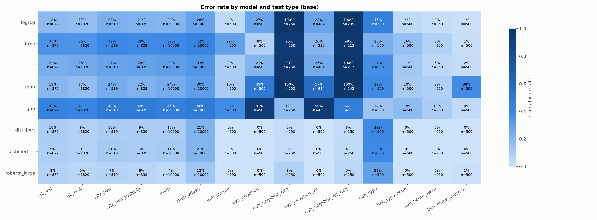
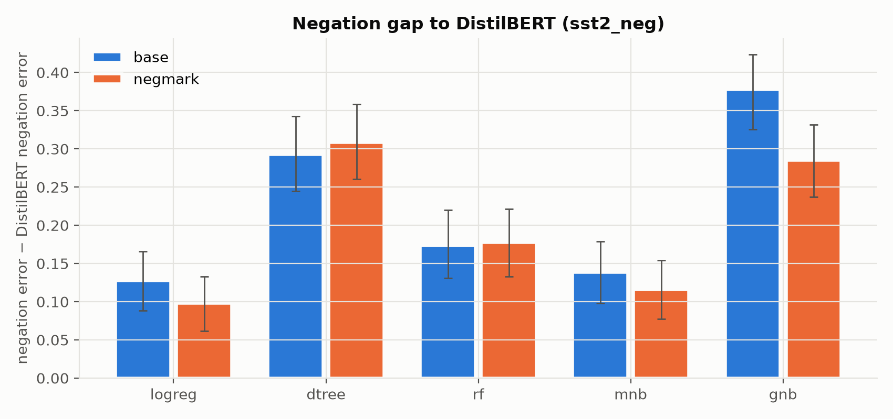
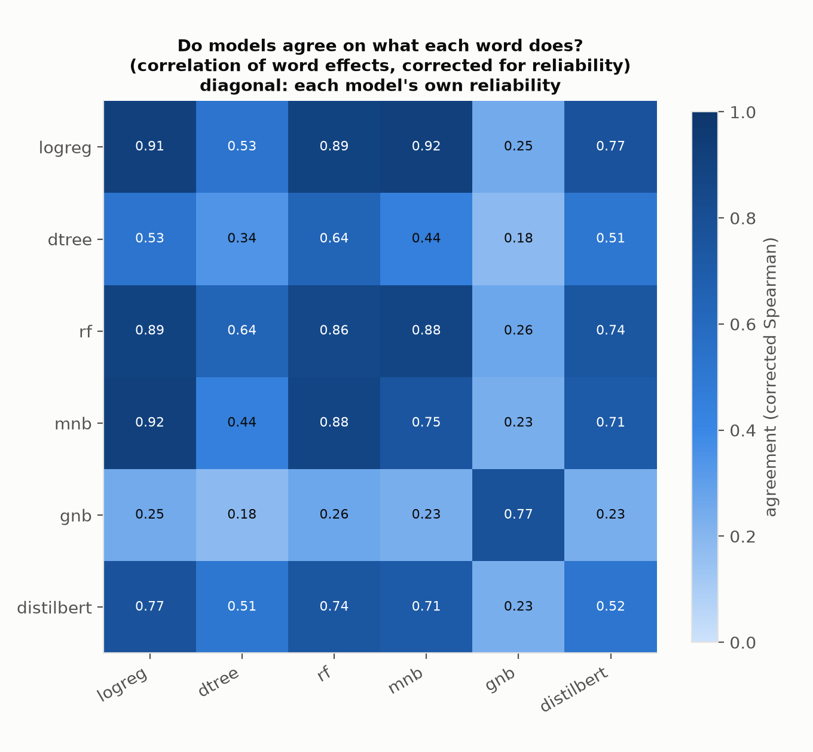
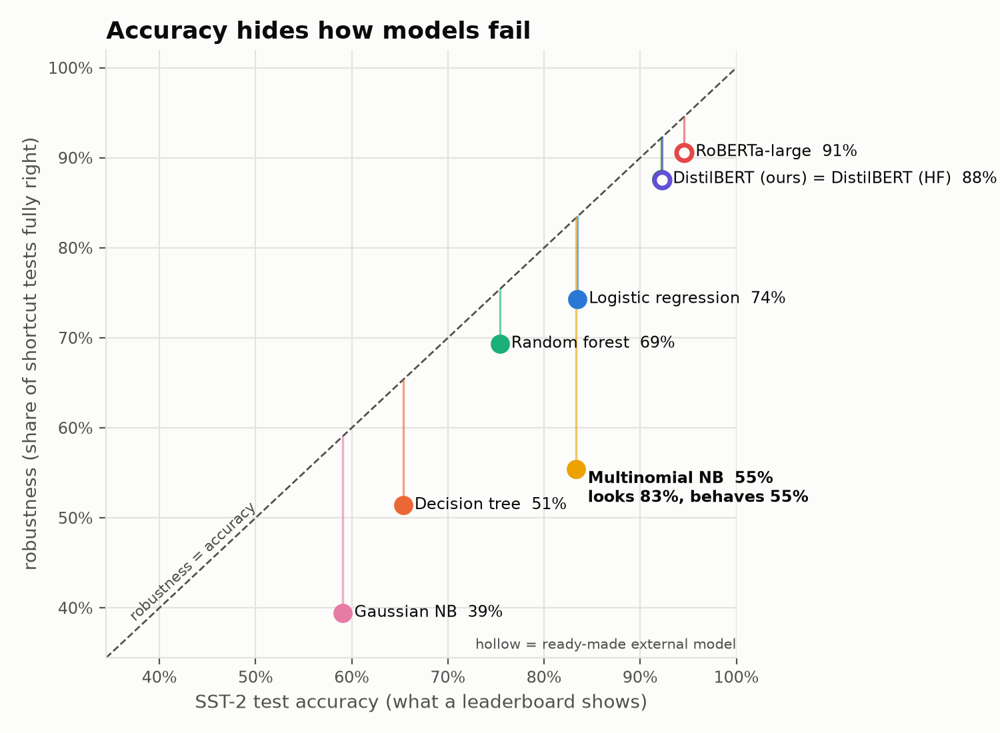

# Mirage: Exposing the Illusion of Accuracy

Detecting shortcut learning in sentiment classifiers — logistic regression, decision tree, random
forest, Multinomial and Gaussian Naive Bayes and DistilBERT — with behavioral tests, negation
marking, explanations and a Gaussian early-warning score on IMDb. Two ready-made models
(RoBERTa-large and Hugging Face's SST-2 DistilBERT) test whether scale cures shortcuts, and a live
demo shows the shortcuts sentence by sentence.

> **Status:** every experiment has run on the real data: classical models locally, DistilBERT and
> the two external models on Kaggle. The numbers below are final; the hypothesis verdicts belong
> in the report.

## Results

Base variants; DistilBERT is the mean of 3 seeds. Full tables are in `results/`, figures in
`figures/`, and every number with its context is in [majordecisions.md](majordecisions.md)
(D35–D38).

| model | SST-2 test | real negated sentences (519) | IMDb (10,000) | ECE on IMDb |
|---|---|---|---|---|
| **DistilBERT** | **0.922** | **0.897** | **0.896** | 0.051 |
| Logistic regression | 0.835 | 0.773 | 0.795 | 0.081 |
| Multinomial NB | 0.834 | 0.761 | 0.760 | 0.229 |
| Random forest | 0.754 | 0.726 | 0.703 | 0.057 |
| Decision tree | 0.653 | 0.607 | 0.612 | 0.200 |
| Gaussian NB | 0.591 | 0.522 | 0.546 | 0.376 |
| *DistilBERT (Hugging Face), external* | *0.923* | *0.892* | *0.893* | *0.082* |
| *RoBERTa-large (SiEBERT), external* | *0.946†* | *0.931†* | *0.956†* | *0.043* |

† possibly contaminated: SiEBERT was very likely trained on SST-2 and IMDb (D39). Its behavioral
results below are clean, because the test sentences are ours.

**Behavioral tests: error rate on hand-built cases**

| model | negation ("X / not X") | typo in sentiment word | typo in noun | name shortcut (Kidman ↔ Seagal) |
|---|---|---|---|---|
| DistilBERT | 0.000 | 0.394 | 0.000 | 0.000 |
| Logistic regression | 0.277 | 0.454 | 0.040 | 0.008 |
| Multinomial NB | 0.572 | 0.386 | 0.102 | 0.376 |
| Random forest | 0.247 | 0.366 | 0.114 | 0.024 |
| *DistilBERT (HF), external* | *0.000* | *0.390* | *0.000* | *0.000* |
| *RoBERTa-large, external* | *0.000* | *0.292* | *0.000* | *0.010* |

**What the results show**
- **Hidden failures (H1):** classical models that score 65–84% on SST-2 fail 20–57% of simple
  negation pairs (Gaussian NB 96%). Naive Bayes flips its answer in 38% of sentences when only a
  film person's name changes.
- **Negation gap (H2):** with single-word features, as the proposal states, every classical
  model is significantly worse than DistilBERT on real negated sentences, by 14–35 points (and by
  12.7–37.8 points with word pairs too).
- **Word pairs and negation marking (H3):** together they close **40%** of logistic regression's
  real-sentence gap (95% CI 21–58%): part, but not all. On templates they close 25–98% for every
  model. On real sentences the other models barely benefit, because real negations are
  longer-range, idiomatic and sometimes doubly negated (D38, D42).
- **Early warning (H4):** low confidence flags IMDb errors well (DistilBERT AUROC 0.836). Embedding
  distance doesn't (0.53), even though it separates the two datasets (0.93, mostly via length).
  The single-word models show the same pattern (confidence 0.55–0.74, distance about 0.5).
- **Shared shortcuts (H5):** ranked the same way for every model (remove a word, measure the
  change; D43), logistic regression, random forest and Multinomial NB agree on what each word does
  almost as much as their own noise allows (0.88–0.92, reliability-corrected). So the shortcuts
  come from the data. Gaussian NB is the exception (0.18–0.26). DistilBERT shares most of their
  word effects too (0.71–0.77); it differs where context matters, such as negation. An earlier
  method, which ranked each model with its own tool, suggested almost no overlap; that was the
  tools, not the models. DistilBERT's IG explanations are faithful (deleting top words hurts 3×
  more than random ones).
- **Does scale cure shortcuts? (D46)** No, it shrinks them. Hugging Face's own DistilBERT behaves
  like ours, typo shortcut included (positive word with a typo: 59% flips vs our 65%), so that
  shortcut comes from SST-2's data. RoBERTa-large is the most robust model (Mirage Gap 0.946 →
  0.906), but typos still flip it (29% of pairs, leaning positive this time), and names still
  nudge it slightly (1% of pairs flip).
- **The name shortcut generalizes (D45).** Every one of the 35 film people in the training data
  was placed in the same sentences. On 23 names never used in the test, Multinomial NB's reaction
  tracks their training reputations at ρ = 0.91 [0.78, 0.96], with effects up to ±0.32 in
  probability.
- **DistilBERT's own shortcut:** when it can't read the sentiment word (a typo), it defaults to
  *negative*. "brilliant" scores 0.999; "brililant" scores 0.010. A typo in the noun changes
  nothing. Fragmented words lean negative in SST-2's training data (D37).



**Seeds (D44):** every result that uses DistilBERT's median seed was rerun on all three seeds.
Across 285 results, no estimate changes direction and no significance verdict changes
(`results/seed_robustness.csv`).

**H2/H3 ladder (D42):** the gap to DistilBERT on the 519 real negated sentences, for single words
→ + word pairs → + negation marking. Logistic regression improves at each step; the decision tree
gets worse.



**H5 (D43):** how much each pair of models agrees on what every word does (diagonal: each model's
agreement with itself).



### The Mirage Gap (D40)

Accuracy against a **robustness score**: the share of shortcut tests a model gets fully right
(negation pairs, real negated sentences, typo pairs and name pairs, equally weighted; a pair
counts only if both sentences are right). Every model behaves worse than it looks. Multinomial NB
and logistic regression have the same SST-2 accuracy (83.4% vs 83.5%), but robustness of 55% vs
74%. The model ordering holds when any one test is left out.



Per-model detail: `figures/shortcut_fingerprint.png`. Both figures also come in 16:9 `_slide`
versions.

## Live demo: the Shortcut Explorer (D41)

Type a sentence, or pick a curated pair, and see every model's verdict, which words drove it, and
two warning flags. Curated pairs include Binoche vs Hopkins (Naive Bayes flips), brilliant vs
brililant (our DistilBERT flips) and a sarcasm example where our models fail.

```bash
.venv/Scripts/python -m pip install -e ".[dl,demo]"
```
```bash
.venv/Scripts/python -m streamlit run app/shortcut_explorer.py
```

The presenter guide is [app/PRESENTING.md](app/PRESENTING.md); fallback images are in `app/screenshots/`.

## Setup (Windows, Python 3.10+)

```bash
python -m venv .venv
# exact versions of the final results: requirements-lock.txt (see its header)
.venv/Scripts/python -m pip install -e ".[dev]"                                        # CPU pipeline + tests
.venv/Scripts/python -m pip install torch --index-url https://download.pytorch.org/whl/cpu
.venv/Scripts/python -m pip install -e ".[dl]"                                         # datasets, DistilBERT, IG, embeddings
```

## Reproduce

```bash
python -m mirage prepare                                  # download SST-2 (+ public test labels) + IMDb, build splits
python -m mirage train-classical --variants base negmark negmark_w3 unigram  # 5 models x 4 variants
# DistilBERT: run notebooks/kaggle_distilbert.ipynb on a free T4 GPU,
# then unzip distilbert_outputs.zip into the repo root (models + DistilBERT predictions)
# External models (optional, D39): run notebooks/kaggle_external.ipynb on Kaggle,
# then unzip external_outputs.zip into the repo root (predictions only)
python -m mirage all                                      # suite -> predict -> evaluate -> explain -> occlusion -> warn -> figures
```

Each stage can also run on its own: `python -m mirage --help`.

## Layout

See [proposal.md](proposal.md) for the research questions and hypotheses,
[ARCHITECTURE.md](ARCHITECTURE.md) for the design and [majordecisions.md](majordecisions.md)
for why each choice was made.

| Folder | Contents |
|---|---|
| `src/mirage/` | the package |
| `configs/` | every setting, one YAML per stage |
| `results/` | CSV outputs, including the reusable `behavioral_suite.csv` |
| `figures/` | report figures (PNG + PDF) |
| `notebooks/` | Kaggle notebooks: DistilBERT fine-tuning, and the external models' predictions |
| `app/` | the live demo (Streamlit), its curated examples and presenter guide |
| `tests/` | `python -m pytest` (131 tests, about 2–3 min, no GPU needed) |

For a file-by-file tour of the code, see [codeexplanations.md](codeexplanations.md).
