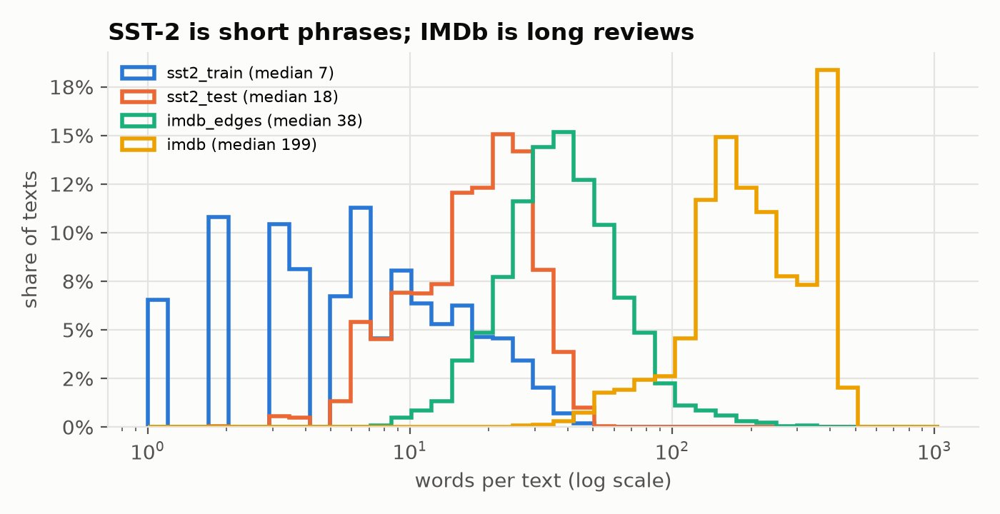

# Datasets: sources, splits, cleaning, and how SST-2 and IMDb differ

Answers GitHub issue #1, points 2, 3 and 5. Every number comes from `results/data_stats.csv`,
`results/dataset_comparison.csv` or `results/dataset_distinctive_words.csv`, written by
`python -m mirage prepare` and `python -m mirage describe` (D58). The code is `src/mirage/data.py`
and `src/mirage/text.py`; the settings are in `configs/data.yaml`.

---

## 1. Where the data comes from

| set | source | what it is |
|---|---|---|
| SST-2 train / validation | `stanfordnlp/sst2` (Hugging Face, the GLUE version) | Movie-review sentences from Rotten Tomatoes critics, **and every phrase inside them**, each labelled positive or negative |
| SST-2 test | `SetFit/sst2` | The same test sentences with their original public Stanford labels. GLUE hides its test labels (they are `-1`), so they are never used (D22) |
| IMDb | `stanfordnlp/imdb`, test split (25,000 reviews) | Full user reviews from the IMDb website, labelled by star rating |
| Template tests | written by us (`src/mirage/behavioral/`) | Short sentences built from word lists to test negation, typos and names (3,750 cases) |

## 2. How the data was split into training, validation and test

| set | rows | positive | used for |
|---|---|---|---|
| `sst2_train` | 63,971 | 55.7% | **Training** every model |
| `sst2_heldout` | 3,378 | 56.5% | **Validation**: choosing each classical model's settings and DistilBERT's best epoch |
| `sst2_val` | 872 | 50.9% | Choosing DistilBERT's median seed; part of the negation set |
| `sst2_test` | 1,820 | 49.9% | **The reported test accuracy** (in-distribution) |
| `sst2_neg` | 519 | 36.0% | Real negated sentences: every `sst2_val` and `sst2_test` sentence with *not*, *never*, *no*, *nothing* or *n't* |
| `imdb` | 10,000 | 50.0% | **Out-of-domain test**: a balanced random sample (seed 42) of the IMDb test split |
| `imdb_edges` | 10,000 | 50.0% | The same reviews, first and last sentence only (to split the IMDb drop into length and content, D31) |

**The training/validation split is made by sentence, not by row (D21).** SST-2's training set has
one row for every phrase of every sentence ("a gorgeous film", "gorgeous", "film" …). A random row
split would put most validation phrases inside a training sentence: we measured 89.6% leakage. Instead
`data.heldout_mask` finds the full sentences, holds out a random 5% of them (seed 42) with every
phrase they contain, and keeps a phrase in training only if no held-out sentence contains it.
Leakage: 0 of 3,378.

**The test set is cleaned of anything seen in training.** Test sentences whose text also appears in
the training or validation data are dropped (`data.drop_seen`): 1 of 1,821.

**Every model sees exactly the same data.** The classical models are tuned on the held-out split and
*not* refit on train + held-out, so they and DistilBERT train on the same 63,971 rows (D10).

**Fresh data for the replication (D53).** `prepare-fresh` draws 10,000 further IMDb reviews (seed
2026), disjoint from the main sample, and a second template suite was generated with new sentence
frames (6,250 rows). Neither was used for anything until the pre-registered claims were scored.

## 3. Data cleaning rules

There is little to clean in SST-2: it is already lowercased and tokenized ("it 's", "does n't").
The rules exist to make *every other text* (IMDb, our templates, anything typed into the demo)
look like SST-2, so each model sees the same token for the same word. They live in one function,
`text.normalize`, which runs **inside** each model, so raw text goes in and nothing is normalized
twice.

| rule | example |
|---|---|
| Remove HTML line breaks (IMDb has them) | `great  The plot` → `great the plot` |
| Straighten curly quotes | `’` → `'` |
| Lowercase | `Brilliant` → `brilliant` |
| Split *n't* the SST-2 way | `doesn't` → `does n't`, `can't` → `ca n't` |
| Split other clitics | `it's` → `it 's`, `they're` → `they 're` |
| Separate punctuation | `great!` → `great !`; `(really)` → `( really )` |
| Keep commas inside numbers | `10,000` stays one token |
| Split sentences glued without a space | `movie.the` → `movie . the` |
| A sentence-final period becomes its own token, abbreviations keep theirs | `ended.` → `ended .`; `mr.`, `l.a.`, `j.` stay whole |
| Collapse repeated whitespace | |

**What is deliberately *not* done.**
- **No stop-word removal.** Standard stop-word lists contain *not*, *no* and *n't*, which would
  delete exactly the negations this project studies.
- **No default scikit-learn tokenizer.** Its default pattern drops one-letter and punctuation tokens,
  including *n't*. The vectorizers split on spaces instead (`tokenizer=str.split`, D8).
- **No stemming or spelling correction:** typo robustness is one of the things being measured.

**Other preparation steps.**
- **IMDb reviews are capped** to their first 220 and last 140 words (`data.head_tail`, D23): 360
  words fit DistilBERT's 512-token limit, and the verdict is often at the end. Every model reads the
  same capped text, so no model gets more of a review than another.
- **Vocabulary floor:** a word or word pair must appear in at least 2 training rows to become a
  feature (`min_df: 2`).
- **Negation marking** (only the `negmark` variants, H3): words after a negation word get a `NOT_`
  prefix up to the next punctuation mark (`not good movie .` → `not NOT_good NOT_movie .`).

## 4. How SST-2 and IMDb differ (differential analysis)

The models are trained on SST-2 and tested on IMDb without seeing any IMDb data, so it matters how
different the two are.

*Words per text (log scale). The IMDb spike at about 360 words is the cap. Source:
`figures/dataset_lengths.png`.*

**Table D1. The sets side by side** (`results/dataset_comparison.csv`; words counted after
normalization; "seen in training" = present in the SST-2 training vocabulary).

| | SST-2 train | SST-2 test | IMDb edges | IMDb (capped) |
|---|---|---|---|---|
| texts | 63,971 | 1,820 | 10,000 | 10,000 |
| positive | 55.7% | 49.9% | 50.0% | 50.0% |
| words per text, median | 7 | 18 | 38 | 199 |
| words per text, 90th percentile | 21 | 31 | 72 | 407 |
| sentences per text | 1.03 | 1.09 | 1.99 | 10.9 |
| distinct words | 14,388 | 7,054 | 25,198 | 60,872 |
| distinct words seen in training | — | 71.6% | 35.1% | **19.5%** |
| running words seen in training | — | 93.4% | 91.5% | 91.4% |
| texts with a negation word | 8.9% | 18.6% | 41.6% | **87.9%** |

**What the differences are.**
1. **Length.** A training row is a phrase (median 7 words); an IMDb review is about 200 words over
   about 11 sentences. This is the largest difference, and the one that makes "unusual compared with
   SST-2" true of almost every review (H4).
2. **Vocabulary.** IMDb uses 60,872 distinct words, four times SST-2's training vocabulary, and only
   19.5% of them were ever seen in training. But the unseen ones are rare: **91.4% of the words a
   model actually reads in IMDb were seen in training**, close to SST-2 test's 93.4%. So the models
   are not mostly reading unknown words.
3. **Negation.** 87.9% of IMDb reviews contain a negation word, against 18.6% of SST-2 test
   sentences, so every model's handling of negation (H2) matters far more on IMDb.
4. **Who writes and what they write about.** The most over-represented words show it
   (`results/dataset_distinctive_words.csv`, add-one smoothed rate ratio):
   - **IMDb:** *imdb, comment, review, watched, agree, spoilers, glad, boyfriend, radio, army*:
     viewers writing about their own viewing, often about the plot.
   - **SST-2:** *filmmaking, meditation, eloquent, wry, timely, joyous, refreshingly, cliches,
     retread, listless, imax*: professional critics' vocabulary.
   - Two entries are spelling differences rather than content: SST-2 writes *can not* as two words
     and spells *humor* the American way, so IMDb's *cannot* and *humour* never occur in SST-2.
5. **Label balance.** SST-2 training is 55.7% positive; IMDb is exactly balanced.

**How much it costs the models, and why.** Every model is less accurate on IMDb than on SST-2 test
(DistilBERT 92.2% → 89.6%). Scoring each review's first and last sentence on its own (`imdb_edges`,
SST-2-like length) splits that drop in two (interestingfindings.md §8): **length helps** every model
(a full review is easier than its two edge sentences, e.g. DistilBERT 10.7 points easier) and
**content hurts** every model (edge sentences are 7–13 points harder than SST-2 test). The models
cope with long text; what they struggle with is what IMDb reviewers write.

*Full results: [interestingfindings.md §8](../results/interestingfindings.md#8-the-imdb-drop-is-about-content-not-length),
[hypothesisanswers.md, H4](../results/hypothesisanswers.md#h4--does-embedding-distance-predict-errors-beyond-confidence).*
