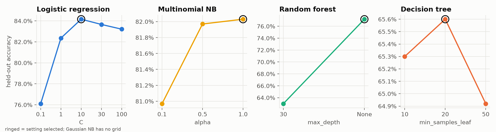
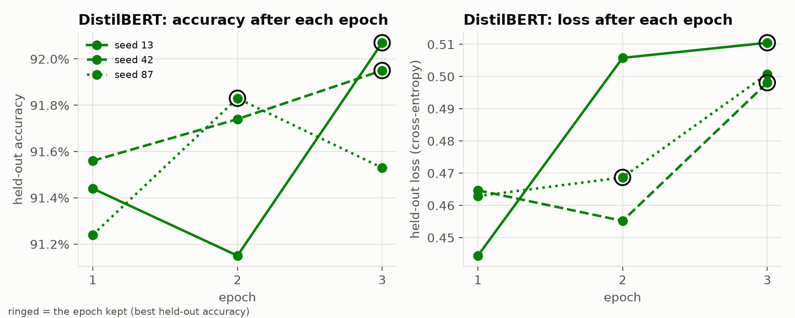

# The models: architectures, hyperparameters, training, testing and deployment

Answers GitHub issue #1, points 1, 4, 6 and 7. One **model card** per model is in [cards/](cards/);
this page compares them. Every number comes from `results/tuning_classical.csv`,
`results/model_summary.csv`, `results/distilbert_training.csv` or `results/main_table.csv` (D58).

| model | family | card |
|---|---|---|
| Logistic regression | linear | [logreg.md](cards/logreg.md) |
| Multinomial Naive Bayes | probabilistic, word counts | [mnb.md](cards/mnb.md) |
| Gaussian Naive Bayes | probabilistic, compressed features | [gnb.md](cards/gnb.md) |
| Decision tree | tree | [dtree.md](cards/dtree.md) |
| Random forest | ensemble of trees | [rf.md](cards/rf.md) |
| DistilBERT (ours) | transformer, fine-tuned by us | [distilbert.md](cards/distilbert.md) |
| DistilBERT (Hugging Face) | transformer, ready-made | [distilbert_hf.md](cards/distilbert_hf.md) |
| RoBERTa-large (SiEBERT) | large transformer, ready-made | [roberta_large.md](cards/roberta_large.md) |

---

## 1. Hyperparameters: what was searched and what was selected

**How the selection works.** Each classical model is fitted once for every setting in its grid on
the 63,971 training rows, scored on the 3,378 held-out rows, and the best held-out accuracy wins
(`models.classical.tune`; ties keep the simpler setting). DistilBERT uses fixed, standard
fine-tuning settings and keeps its best epoch on the same held-out rows. Nothing is ever chosen on
the test set.

**Shared by all five classical models** (`configs/classical.yaml`): word and word-pair features
(n-grams 1–2) appearing in at least 2 training rows, which gives **75,905 features**; TF-IDF
weighting with sublinear term frequency (raw counts for Multinomial NB); seed 42.

| model | fixed settings | searched | **selected** | held-out accuracy |
|---|---|---|---|---|
| Logistic regression | L2 penalty, `liblinear` solver, max 1,000 iterations | C ∈ {0.1, 1, 10, 30, 100} | **C = 10** | 84.2% |
| Multinomial NB | word counts | alpha ∈ {0.1, 0.5, 1.0} | **alpha = 1.0** | 82.0% |
| Gaussian NB | TF-IDF → 300 SVD components | none (no hyperparameter to tune) | — | 56.3% |
| Decision tree | Gini criterion, unlimited depth | min. samples per leaf ∈ {10, 20, 50} | **20** | 65.6% |
| Random forest | 300 trees, √features per split | max depth ∈ {30, unlimited} | **unlimited** | 77.2% |
| DistilBERT (ours) | `distilbert-base-uncased`; learning rate 2e-5, linear decay, 6% warm-up; batch 32 per GPU × 2 GPUs; 3 epochs; up to 128 tokens (512 for IMDb, first + last tokens kept); mixed precision; seeds 13 / 42 / 87 | best epoch (by held-out accuracy) | **epoch 3, 3, 2** | 92.1% / 92.0% / 91.8% |
| HF DistilBERT, RoBERTa-large | ready-made, not trained by us; up to 128 tokens (512 for IMDb) | — | — | — |

The variants for the negation experiments (`negmark`, `negmark_w3`, `unigram`) were tuned the same
way; every setting tried, for every variant, is in `results/tuning_classical.csv`.

**Why these grids.** The decision tree's leaves were kept at 10 or more examples because a fully
grown tree (1 example per leaf) gives only 0%/100% probabilities and no usable confidence, for 0.2
points of accuracy (D29). The logistic regression grid was widened to 100 after C = 10 sat at the
edge of an earlier grid. DistilBERT was **not** tuned (shortfall C3): the classical models get a
search and DistilBERT doesn't, which can only understate DistilBERT's advantage.

## 2. Training curves

**Classical models have no epochs.** They are fitted in one pass (or, for the trees, one tree-growing
run), so there is no epoch-by-epoch curve. The equivalent is the **tuning curve**: held-out accuracy
for each setting tried.



*Classical tuning curves (base variant); the ringed point is the setting selected. Logistic
regression peaks at C = 10 and declines as the penalty weakens (overfitting); the random forest
needs unlimited depth (77.2% vs 63.0% at depth 30); the decision tree's best leaf size is 20.
Source: `results/tuning_classical.csv`.*

**DistilBERT** is evaluated on the held-out rows after each epoch.



*DistilBERT, three seeds. Accuracy moves within about one point (91.1–92.1%) across epochs: most of
the learning happens in the first epoch. The held-out loss rises by epoch 3 for every seed while
accuracy stays level or improves: the model becomes more confident, including on the examples it
gets wrong, which is the usual first sign of overfitting. Keeping the best epoch by accuracy (ringed) gives
epochs 3, 3 and 2. Source: `results/distilbert_training.csv`.*

The training loss logged during training is not plotted: on Kaggle's two GPUs the Trainer's logged
value starts at 1.33, above what a two-class loss can be when averaged correctly, so it is not a
trustworthy curve. The held-out loss is.

## 3. Model size

| model | features | learned numbers ("parameters") | structure |
|---|---|---|---|
| Logistic regression | 75,905 | 75,906 | one weight per feature + a bias |
| Multinomial NB | 75,905 | 151,812 | one log-probability per feature and class + 2 class priors |
| Gaussian NB | 75,905 → 300 | 22,772,702 | almost all of it the 300 × 75,905 SVD projection; the classifier itself is a mean and variance per component and class |
| Decision tree | 75,905 | 4,089 nodes | depth 419, 2,045 leaves |
| Random forest | 75,905 | 10,738,128 nodes | 300 trees, average depth 3,900, 5.4 million leaves |
| DistilBERT (ours) | 30,522 word pieces | 66,955,010 | 6 transformer layers, 768 dimensions, 12 attention heads |
| HF DistilBERT | 30,522 word pieces | about 66 million (published) | same architecture as ours |
| RoBERTa-large | 50,265 word pieces | about 355 million (published) | 24 layers, 1,024 dimensions, 16 heads |

*Sources: `results/model_summary.csv` (our models, counted from the saved files); the external
models' published model cards.*

## 4. How the models were trained, saved, tested and deployed

```
prepare ─► train-classical ─► artifacts/models/{model}__{variant}__seed42/   (laptop CPU)
        └► Kaggle notebook ──► artifacts/models/distilbert__base__seed{13,42,87}/   (free T4 GPUs)
                               │
                 predict ◄─────┘   loads every saved model, scores every evaluation set
                    │
   results/predictions/{model}__{variant}__seed{seed}__{dataset}.parquet   ← the contract
                    │
   evaluate / explain / warn / figures   (read only these files)
```

1. **Training.** The classical models train on the laptop (`python -m mirage train-classical`,
   seconds to minutes each; the random forest about 4 minutes). DistilBERT trains on Kaggle's free
   GPUs (`notebooks/kaggle_distilbert.ipynb`, about 9 minutes per seed on two T4s).
2. **Saving.** Each trained model is saved to its own folder: classical models as one `model.joblib`
   file (the whole text-to-prediction pipeline, so normalization and the vectorizer travel with the
   model) plus the settings used (`config.json`); DistilBERT as Hugging Face files (weights,
   tokenizer, config) plus `train_summary.json` with its training history.
3. **Testing.** `python -m mirage predict` loads every saved model through one interface
   (`models.base.load_classifier`, `predict_proba(raw texts)`) and scores every evaluation set: the
   SST-2 held-out, validation and **test** sets, the real negation set, the template tests and the
   IMDb sets. Each run writes one predictions file, which is validated (required columns, one row per
   item, probabilities between 0 and 1, 0/1 labels, and a verdict that matches its probability)
   before anything reads it. Accuracy, F1, calibration and every
   other metric are computed from these files by `python -m mirage evaluate`, so the test results
   can always be recomputed without re-running a model. The test set is used only for reporting.
4. **Deployment.** The models are deployed locally in the **Shortcut Explorer** demo
   (`python -m streamlit run app/shortcut_explorer.py`): it loads the saved models from disk (no
   internet needed after the first start), runs any sentence through all eight, and shows each
   model's verdict, which words drove it, and whether it flipped. The demo's logic is tested
   (`tests/test_demo.py`), including that every curated example still behaves as documented. The
   models are not served online.

**Test results** (`results/main_table.csv`; DistilBERT: mean of 3 seeds):

| model | SST-2 test accuracy | macro F1 | real negated sentences | IMDb |
|---|---|---|---|---|
| DistilBERT (ours) | 0.922 | 0.922 | 0.897 | 0.896 |
| Logistic regression | 0.835 | 0.834 | 0.773 | 0.795 |
| Multinomial NB | 0.834 | 0.833 | 0.761 | 0.760 |
| Random forest | 0.754 | 0.753 | 0.726 | 0.703 |
| Decision tree | 0.653 | 0.652 | 0.607 | 0.612 |
| Gaussian NB | 0.591 | 0.589 | 0.522 | 0.546 |
| *HF DistilBERT* | *0.923* | *0.923* | *0.892* | *0.893* |
| *RoBERTa-large* | *0.946†* | *0.946†* | *0.931†* | *0.956†* |

† possibly inflated: RoBERTa-large was very likely trained on SST-2 and IMDb (shortfall C12).
