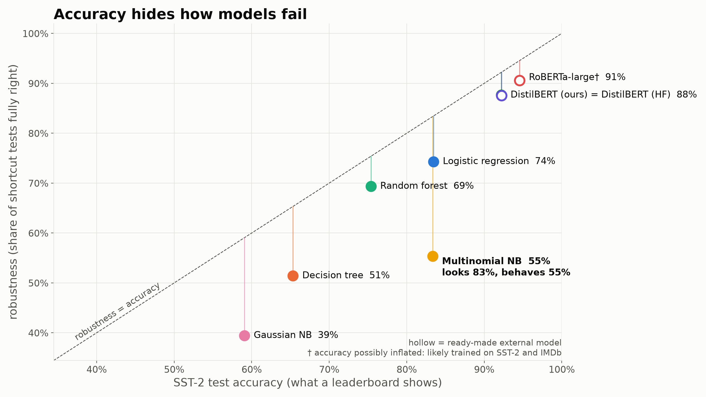
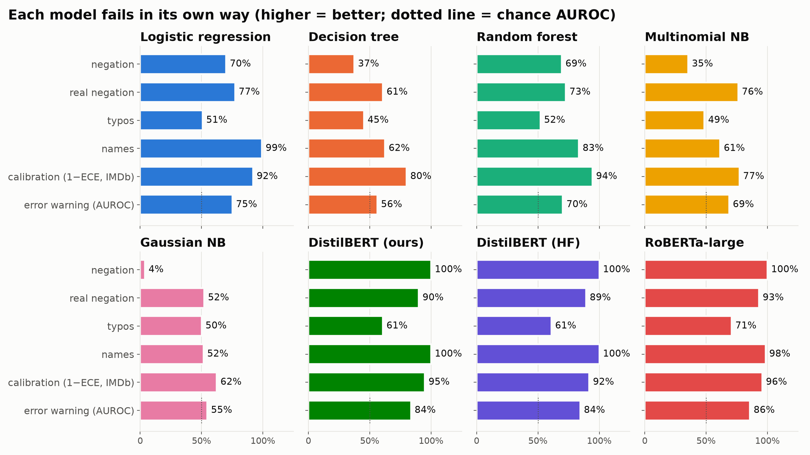
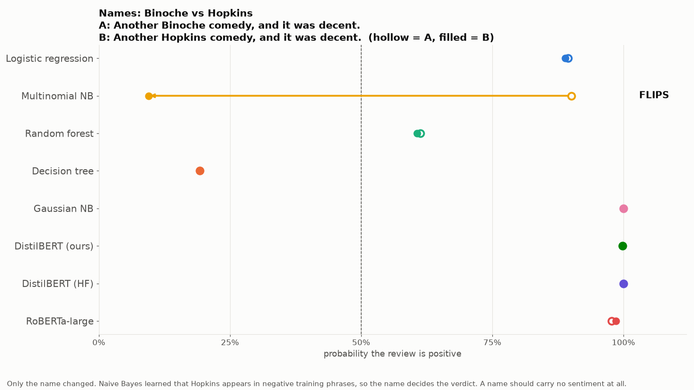
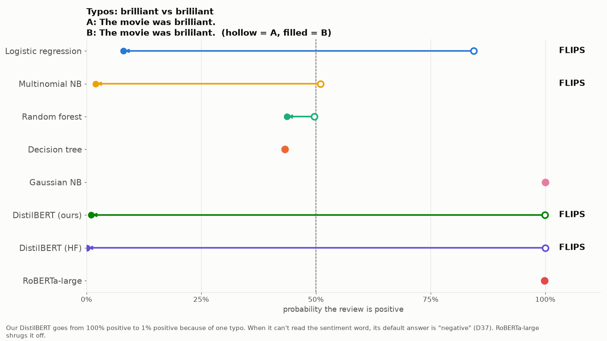
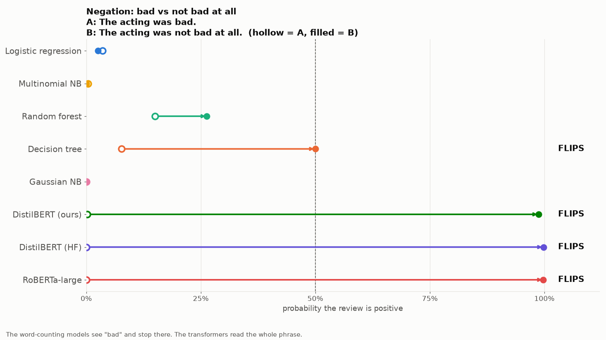

# Mirage: Exposing the Illusion of Accuracy

**Shortcut learning in sentiment classifiers: what a leaderboard shows, and what the models
actually do.**

Aditeya Kayal · project report (a companion to the presentation)

> **How to use this report.** It is written to prepare the presentation: the main result, the
> Mirage Gap, is explained in full (Section 2) with its figures and the live demo; the
> hypotheses (Section 3) and the supporting findings (Section 4) that explain the gap follow, each
> short but with its evidence. Every number comes from `results/*.csv`; the complete versions,
> with every confidence interval, are in [hypothesisanswers.md](../results/hypothesisanswers.md)
> and [interestingfindings.md](../results/interestingfindings.md). "D*nn*" points to the
> entry in [majordecisions.md](../design/majordecisions.md) that explains a choice.

---

## Summary

A sentiment model can score over 90% on a benchmark while reading the wrong things. This project
trained five classical models (logistic regression, Multinomial and Gaussian Naive Bayes, a
decision tree, a random forest) and fine-tuned DistilBERT on SST-2 movie-review sentences, added
two ready-made transformers for comparison (Hugging Face's DistilBERT and the 5× larger
RoBERTa-large), and tested all eight on targeted shortcut tests, on real negated sentences and on
10,000 IMDb reviews.

The headline is the **Mirage Gap**: for every model, accuracy overstates how well it behaves. Two
models with identical accuracy, logistic regression and Multinomial Naive Bayes (83.5% vs
83.4%), differ by **19 points** in robustness, because Naive Bayes changes its verdict when only
an actor's name changes and misses most negations. The transformers have the smallest gaps, but
even they flip on one misspelled word. The hypotheses explain where the gap comes from: shortcuts
that the training data teaches every model (H5), context that only transformers can use (H2),
failures that the normal test set never shows (H1), and the fact that "unusual input" is not a
warning sign of an error, while the model's own confidence is (H4). Sixteen of seventeen claims
written down in advance held on fresh data.

---

## 1. The project in one page

**The problem (proposal).** High test accuracy doesn't prove a model learned the task: it may
rely on cues that happen to go with the label in the training data, like the word "good" in "not
good", or an actor's name. Standard test sets don't catch this, because they share the training
data's shortcuts.

**Research questions.**
1. *Hidden failures:* how much more do models err on negation and typos than on normal sentences?
2. *What context buys:* how much better does a transformer handle negation than word-counting
   models?
3. *Early warning:* can we tell in advance when a model is likely to be wrong on unfamiliar data?
4. *Explanation:* which words do models rely on, and do different model families rely on the
   same ones?

**Data.** SST-2 (movie-review phrases; 63,971 training phrases, 1,820 test sentences with public
labels), a real negation set (519 SST-2 sentences containing *not*, *never*, *n't* …), 10,000
IMDb reviews (long reviews from another website), and a suite of template tests we wrote
ourselves (3,750 cases: negation, typos, names, with controls).

**Models.** Five classical models on word and word-pair features (TF-IDF), our fine-tuned
DistilBERT (3 seeds), and two ready-made transformers that we didn't train.

| model | SST-2 test accuracy | real negated sentences | IMDb (10,000 reviews) |
|---|---|---|---|
| DistilBERT (ours) | 0.922 | 0.897 | 0.896 |
| Logistic regression | 0.835 | 0.773 | 0.795 |
| Multinomial NB | 0.834 | 0.761 | 0.760 |
| Random forest | 0.754 | 0.726 | 0.703 |
| Decision tree | 0.653 | 0.607 | 0.612 |
| Gaussian NB | 0.591 | 0.522 | 0.546 |
| *HF DistilBERT (external)* | *0.923* | *0.892* | *0.893* |
| *RoBERTa-large (external)* | *0.946†* | *0.931†* | *0.956†* |

† possibly inflated: RoBERTa-large (SiEBERT) was very likely trained on SST-2 and IMDb. Its
behaviour on our own test sentences is unaffected. *Source: `results/main_table.csv`
(DistilBERT: mean of 3 seeds).*

**Why logistic regression and Multinomial NB are far more accurate than the other classical
models.** The answer is in how each model uses the words. A sentence's sentiment is spread over
many words, and an SST-2 test sentence switches on only about 25 of the 75,905 word and
word-pair features (median 25).
- **Logistic regression and Multinomial NB (83%) let every word vote.** Logistic regression adds
  up one learned weight per word or pair; Multinomial NB multiplies each word's probability under
  "positive" and "negative". Either way, *every* sentiment word in the sentence counts, and
  regularization (LR) or smoothing (NB) stops a rare word from dominating. Summing many weak,
  independent clues is exactly what sparse text rewards.
- **The decision tree (65%) asks one question per level.** A sentence follows a single path of
  yes/no questions ("does it contain *bad*?"), so it is judged on the few words on that path, and
  the rest are ignored. To separate 64,000 phrases on single words, the tree grows 419 levels deep and
  memorizes training quirks.
- **The random forest (75%) averages 300 such trees**, which cancels much of the single tree's
  noise. But each split may only choose among a random 275 of the 75,905 features, and for a
  sentence with 25 active features about 9 splits in 10 see none of its words, so a tree often has
  to decide on a weak or irrelevant feature.
- **Gaussian NB (59%) can't see individual words at all.** It needs a few continuous numbers, so
  the 75,905 features are compressed into 300 SVD components (mixtures of thousands of words), and
  it then assumes each follows a bell curve, which word data doesn't. Most word-level evidence is
  lost in the compression (H6).
- **DistilBERT (92%) goes further than counting:** it was pre-trained on large amounts of English
  before seeing SST-2, and it reads each word in its context, so "not good" means something
  different from "good".

---

## 2. The Mirage Gap: accuracy hides how models fail

### 2.1 The idea

Two numbers per model:
- **Accuracy, "how a model looks":** the share of the 1,820 SST-2 test sentences classified
  correctly. These are ordinary sentences, like the training data, so a model can score well by
  spotting familiar words without reading the sentence. This is the number a leaderboard shows.
- **Robustness, "how a model behaves":** the average of four shortcut checks. Each check is the
  share of its cases the model gets **fully** right:

| check | example | passed when… |
|---|---|---|
| negation | "The film was good." / "The film was not good." | both sentences are right, so the verdict flips |
| real negation | 519 real SST-2 sentences with a negation | the sentence is right |
| typos | "The movie was brilliant." / "The movie was brililant." | both are right: a typo shouldn't change the verdict |
| names | "Another Kidman comedy, and it was decent." / "Another Seagal comedy, …" | both are right: a name shouldn't change the verdict |

**Mirage Gap = accuracy − robustness.** It measures how much better a model looks on the
leaderboard than it behaves when you change only what should (a negation) or shouldn't (a typo,
a name) change the answer.

**Why "both sentences right".** In a first version, a pair counted as passed if the verdict
simply didn't change. The weakest models then looked the most robust: a model that can't read the
sentiment word never changes its answer, so it never "fails" (the decision tree scored 79%
robustness against 65% accuracy; Section 4, finding 9). Requiring both sentences to be right means
robustness can't be higher than competence (D40).

### 2.2 The result



*Figure 1. Accuracy (x) against robustness (y). The dashed line is "behaves exactly as well as it
looks"; the vertical drop from it is each model's Mirage Gap. Every model sits below the line.
Source: `results/mirage_gap.csv`, `figures/mirage_gap_slide.png`.*

**Table 1. The Mirage Gap, base models, sorted by gap.**

| model | accuracy | negation | real negation | typos | names | robustness | **Mirage Gap** |
|---|---|---|---|---|---|---|---|
| Multinomial NB | 0.834 | 0.354 | 0.761 | 0.486 | 0.614 | 0.554 | **0.280** |
| Gaussian NB | 0.591 | 0.038 | 0.522 | 0.502 | 0.516 | 0.395 | 0.196 |
| Decision tree | 0.653 | 0.374 | 0.607 | 0.452 | 0.624 | 0.514 | 0.139 |
| Logistic regression | 0.835 | 0.700 | 0.773 | 0.508 | 0.992 | 0.743 | 0.091 |
| Random forest | 0.754 | 0.694 | 0.726 | 0.520 | 0.834 | 0.694 | 0.060 |
| HF DistilBERT | 0.923 | 1.000 | 0.892 | 0.610 | 1.000 | 0.876 | 0.047 |
| DistilBERT (ours) | 0.922 | 1.000 | 0.900 | 0.606 | 1.000 | 0.876 | 0.046 |
| RoBERTa-large | 0.946† | 1.000 | 0.931† | 0.708 | 0.984 | 0.906 | 0.040 |

*DistilBERT at its median seed (13). † see Section 1.*

### 2.3 What it shows

1. **Every model behaves worse than it looks.** All eight are below the line; the gaps range from
   0.04 to 0.28.
2. **The leaderboard twins.** Logistic regression and Multinomial NB are indistinguishable on
   accuracy (83.5% vs 83.4%). Multinomial NB's robustness is **19 points lower** (0.554 vs 0.743)
   and its gap is three times larger. Two checks make the difference: **names** (61% vs 99% of
   pairs right: Naive Bayes flips when only an actor's name changes) and **negation** (35% vs
   70%). A leaderboard would call these two models equal; their behaviour is not.
3. **Accuracy doesn't even rank the gaps.** The largest gap belongs to one of the most accurate
   classical models (Multinomial NB), not to the least accurate one (Gaussian NB, 0.196).
4. **Transformers have the smallest gaps, but not zero.** They pass every negation pair and every
   name pair. What remains is typos, where every model is weakest (45–71% of pairs right): our
   DistilBERT passes only 61%, because it reads a misspelled sentiment word as "negative"
   (finding 2).
5. **Fixing a shortcut closes the gap.** Adding negation marking to the classical models (words
   after "not" get a separate feature) narrows the gap for all five: logistic regression from 0.091
   to 0.040, the random forest from 0.060 to 0.018, Multinomial NB from 0.280 to 0.202. The gap
   moves exactly where the shortcut was.

### 2.4 Each model fails in its own way



*Figure 2. The "shortcut fingerprint": each model's score on the four robustness checks, plus
calibration and how well its confidence warns of errors (Section 3, H4). Source:
`results/shortcut_fingerprint.csv`.*

The same robustness number can hide different weaknesses. Multinomial NB fails on names and
negation; Gaussian NB on negation (4%) and almost everything else; logistic regression mainly on
typos; the transformers only on typos. This is why the gap is a summary and the fingerprint is the
diagnosis.

**Why each model's gap is the size it is.** Each gap follows from how the model works (Section 1).

| model | gap | why |
|---|---|---|
| Multinomial NB | **0.280** | Every word votes at the full strength of its training statistics. That is good for accuracy, but it also means a name with a skewed history (a director whose films were mostly panned) outvotes the real sentiment (61% of name pairs), and "not" can't outvote "good" (35% of negation pairs). Its high accuracy has the most to lose. |
| Gaussian NB | 0.196 | It can barely read individual words (compressed to 300 components), so it fails almost every check (negation 4%). Its gap is smaller than Multinomial NB's only because its accuracy is low to begin with. |
| Decision tree | 0.139 | It judges a sentence on the few words along one path, so a negation or a misspelled word that isn't on that path is missed or misread (negation 37%, typos 45%). |
| Logistic regression | 0.091 | Regularization shrinks rare words such as names to small weights (99% of name pairs), and word pairs like `not good` give it partial negation (70%). But a misspelled word is simply outside its vocabulary, so typos remain its weak spot (51%). |
| Random forest | 0.060 | Averaging 300 trees smooths out single-word quirks (names 83%, negation 69%). Its gap is small partly because its accuracy (75%) is lower, so there is less to lose. |
| DistilBERT, both versions | 0.046–0.047 | Reading words in context fixes negation (100%) and makes names irrelevant (100%). What's left is typos (61%): a misspelled sentiment word is split into unfamiliar word pieces, and its learned default for those is "negative" (finding 2). |
| RoBERTa-large | 0.040 | The same mechanism with 5× the size and 15 training datasets: typos are its only weakness and a smaller one (71%). |

### 2.5 Seeing it live: the Shortcut Explorer

The local demo app runs all eight models on any sentence or pair of sentences and shows which
ones flip. Run it with:

```bash
.venv/Scripts/python -m streamlit run app/shortcut_explorer.py
```

It opens at http://localhost:8501 and works offline once the models are cached. With **Show
research numbers** on (sidebar), each model is labelled with its "looks → behaves" (accuracy →
robustness), so every live example is tied back to Figure 1. The presenter guide is
[app/PRESENTING.md](../../app/PRESENTING.md); every curated example's behaviour is checked by
the tests, so it won't surprise you. In each chart below, the hollow dot is sentence A, the filled
dot sentence B, and an arrow that crosses the 50% line is a flipped verdict.

**Names: the twins split.** Only the actor's name changes. Multinomial NB goes from 90% positive
to 10%; logistic regression, its accuracy twin, doesn't move. This is the names column of Table 1
in one sentence.



**Typos: the transformers' remaining gap.** One typo in "brilliant" sends both DistilBERTs from
100% positive to about 1%; RoBERTa-large shrugs it off. The control example (a typo in the noun,
"The moive was brilliant.") moves nothing, so it is the *sentiment word* that matters
(finding 2).



**Negation: what context buys.** "The acting was bad." → "The acting was not bad at all." All
three transformers flip to positive; logistic regression and both Naive Bayes models stay
negative, because they see "bad" (H2).



Other curated examples in the app: names with RoBERTa-large (it flips on Kidman vs Seagal, though
rarely across the full test), double negation, "but I did" contrast, unknown words, and sarcasm as
a planned failure. Fallback images of all of them are in `app/screenshots/`.

### 2.6 How solid is it?

- **Replicated on fresh data.** Before scoring new data, we wrote down that Multinomial NB would
  pass at least 10 points fewer negation, typo and name pairs than logistic regression (claim 10).
  On a second test suite with newly worded sentences: **0.597 vs 0.456**, a 14-point difference.
- **Not an artefact of the score's design.** Leaving out each of the four checks in turn keeps the
  model order identical in 14 of 16 cases; the other two swap one pair of neighbours with the same
  best and worst model (`results/mirage_gap_sensitivity.csv`).
- **Not an artefact of DistilBERT's seed.** Its gap is 0.046 / 0.044 / 0.043 on its three seeds,
  and its rank never changes.

**Caveats to state.**
- The gap is a summary, not a probability: accuracy and robustness are measured on different
  sentences, so 0.28 doesn't mean "28% of sentences are right for the wrong reason". Compare gaps
  between models.
- The score was defined after the first results were in (exploratory), which is why its key
  claim was then tested on fresh data.
- The robustness score itself has no confidence interval; its components do, and the twins'
  19-point difference is far larger than them.
- Template checks depend on how the test sentences are worded (finding 15).

*Full version: [hypothesisanswers.md, the Mirage Gap](../results/hypothesisanswers.md#the-mirage-gap--the-headline-result).*

---

## 3. What explains the gap: the hypotheses

Four of the proposal's hypotheses explain the Mirage Gap. Each is stated with its verdict, the
evidence, and why it came out that way. (H3, negation marking, and H6, Gaussian vs Multinomial NB,
are side results and are left out; they are in hypothesisanswers.md.)

### H1: hidden failures on negation and typos — *partly supported*

> *Every model, including DistilBERT, has a clearly higher error rate on negation and
> sentiment-word typos than on the normal test set.*

**Evidence** (error rate on the test minus error on normal test sentences without negation;
`results/h1_test.csv`):

| | real negation | typos |
|---|---|---|
| Logistic regression | **+7.3** points | **+29.9** |
| Multinomial NB | **+8.4** | **+23.1** |
| DistilBERT (ours) | +2.6 (not significant) | **+32.0** [20.1, 42.4] |
| RoBERTa-large | +1.6 (not significant) | **+23.9** |

**Verdict.** The **typo half holds for every model that reads sentiment words, DistilBERT
included**: its typo error (39%) is five times its normal error. The **negation half holds only
for the word-counting models**; the transformers make no negation-template errors at all.

**Why it matters for the gap.** These are exactly the failures accuracy can't see: the normal test
set has few typos and its negations are a small share. The typo column of Table 1 is why even the
transformers have a gap.

### H2: what context buys — *supported, with one replication caveat*

> *DistilBERT handles negation much better than bag-of-words models with single-word features.*

**Evidence** (single-word model's error − DistilBERT's error on the same sentences;
`results/negation_gap.csv`): on the 519 real negated sentences DistilBERT is **14 to 35 points
better** than every single-word model (logistic regression +16.4 [12.3, 20.6]; all Holm
p < 0.001), and 9 to 100 points better on the negation templates. DistilBERT errs on 10% of real
negated sentences where single-word logistic regression errs on 26%.

**Why.** A word-counting model sees "not" and "good" as separate, unordered features, so "good"
pushes positive whatever comes before it. DistilBERT's attention combines each word with its
context, so "not" can reverse the word it modifies. The negation demo (Section 2.5) shows this
directly.

**The replication caveat.** On the second suite, our DistilBERT reads **"I would never call the
movie great."** as positive in 96% of cases (it gets every other new negation right). That made
one pre-registered claim fail: the decision tree and random forest were no longer 10 points
behind it. So the transformer advantage holds for the negations the training data shows most,
not for every construction (finding 15).

### H4: early warning — *rejected*

> *A Gaussian distance on sentence embeddings (how unusual a review is compared with the training
> data) adds information beyond the model's own confidence for predicting its errors on IMDb.*

**Evidence** (AUROC for picking out the IMDb reviews each model gets wrong; 0.5 = chance;
`results/early_warning.csv`):
- **Distance: 0.49–0.53 for every model, chance level.** Low confidence: **0.55–0.86**, a useful
  signal, best for the strongest models (DistilBERT 0.836).
- Combining distance with confidence adds nothing for seven of eight models (Multinomial NB gains
  a negligible 0.012).
- The distance does work as a detector of *unfamiliar text*: it tells IMDb from SST-2 with AUROC
  0.926. It just doesn't say *which* IMDb reviews are hard.
- **Even in DistilBERT's own internal features** (the standard Lee et al. detector), distance
  reaches 0.82, but those are the same reviews its confidence already flags: combined, +0.000.
- **Replicated** on 10,000 fresh IMDb reviews: distance 0.50–0.53 for all eight models.

**Why.** Almost every IMDb review is unusual compared with SST-2's short phrases (it is longer,
in a different style), so "unusual" describes the whole dataset, not the hard reviews. Errors come
from content, such as mixed sentiment or a twist at the end (finding 8), which the model's own
confidence partly reflects.

**Why it matters for the gap.** The Mirage Gap says accuracy can't be trusted on its own; H4
says what *can* help in practice: a model's confidence is an honest warning signal, a generic
"unusual input" score is not.

### H5: shared shortcuts — *supported for the three main classical models*

> *Classical models share many of the same top shortcut words, suggesting the shortcuts come from
> the data.*

**Evidence.** Every model was measured the same way: remove a word from a sentence and see how far
P(positive) moves, averaged over 773 words. Logistic regression, the random forest and Multinomial
NB agree on these word effects at **0.88–0.92** (Spearman correlation, corrected for each model's
own noise; `results/explain/occlusion_agreement.csv`). Gaussian NB and the decision tree are
exceptions: they read individual words too weakly or too sparsely to agree with anyone.

**Why.** Three models with different learning rules (a linear model, an ensemble of trees, a
probabilistic model) rely on the same words in the same direction, so the shortcuts come from the
training labels, not from any one algorithm.

**Why it matters for the gap.** It explains why every model has a gap: they all learn from the
same skewed data. The names shortcut (finding 5) and "IMAX" (finding 10) are two concrete cases.

---

## 4. Supporting findings

Each of these explains part of the gap or tests how far it holds. The numbers are from
[interestingfindings.md](../results/interestingfindings.md), where each has its full table.

### Finding 2: DistilBERT's default: an unreadable sentiment word means "negative"

**What.** One typo in a positive adjective flips DistilBERT to negative in **65%** of pairs
("The movie was brilliant." 0.999 positive → "The movie was brililant." 0.010). A typo in a
negative adjective flips only 9%, and a typo in the noun ("The moive was brilliant.") flips
**0%**.

**Why.** It is not general fragility (the noun control rules that out) but a learned default for a
sentiment word it can't read. DistilBERT splits unknown words into fragments, and in SST-2's
training phrases fragmented words are more common in negative phrases (16.0% of words vs 10.9%);
phrases with a fragment are 49.9% positive against 61.4% without. So "unreadable" leans negative.
Hugging Face's independently trained DistilBERT shows the same default (59% flips).

**Significance.** It is the transformers' whole remaining Mirage Gap, and the typo half of H1.

### Finding 5: Naive Bayes judges a film by who made it

**What.** Changing only a film person's name flips Multinomial NB's verdict in **38%** of 500
pairs; DistilBERT in 0%. To check it isn't specific to the tested names, all 35 film people with
at least 15 training phrases were put into the same 40 neutral sentences: Multinomial NB's reaction
to each name follows that name's reputation in the training data with **ρ = 0.91** on the 23 names
never used in any test, with effects up to ±0.32 in probability.

**Why.** In SST-2 each director or actor appears in phrases with a particular balance of positive
and negative labels. Naive Bayes turns that balance straight into a vote, so it has memorised each
person's reputation. Logistic regression shrinks those weights (its names score is 99%).

**Significance.** It is the main reason the leaderboard twins differ (Table 1, names column), and a
clean example of H5: a shortcut taught by the data.

### Finding 8: the IMDb drop is about content, not length

**What.** Every model is worse on IMDb than on SST-2. To find out why, each review's first and last
sentence was scored on its own (44 words, close to SST-2's length). That splits the drop into two
parts: **length/format is negative for every model** (a full review is *easier*, e.g. DistilBERT
−10.7 points) and **content is positive for every model** (+7 to +13 points).

**Why.** A long review contains more evidence, so length helps; what hurts is what IMDb reviews
say (mixed opinions, plot summaries, irony) compared with SST-2's short phrases. Short-phrase
training did not make the models bad at long text.

**Significance.** It explains H4's result: the distance detects length and style, which don't cause
errors, while the errors come from content, which the distance doesn't see.

### Finding 9: a model that can't read can't be fooled

**What.** The two weakest models make *fewer* errors on typo tests than on normal sentences (the
decision tree −10.8 points, Gaussian NB −25.4). Under a first version of the robustness score,
the decision tree came out more robust (79%) than accurate (65%).

**Why.** A typo test asks whether the verdict changes when the sentiment word is lost. A model that
barely uses that word in the first place doesn't change its answer, so it "passes" for the wrong
reason.

**Significance.** This is why the Mirage Gap counts a pair as passed only when both sentences are
right (Section 2.1). It is also a warning for any robustness test: not reacting is not the same as
being robust.

### Finding 10: DistilBERT shares the classical models' sentiment words

**What.** Measured the same way as H5, DistilBERT agrees with logistic regression, the random
forest and Multinomial NB at **0.71–0.77** (corrected): less than they agree with each other, far
more than "different words". One shared word is a pure shortcut: **"IMAX"** appears in 54 training
phrases, 96% of them positive (the average is 56%). Removing it drops DistilBERT's P(positive) by
0.31 on average, its 10th most influential word.

**Why.** All models learn from the same labels, and the labels make some incidental words reliably
positive. DistilBERT differs from the classical models where context matters (negation), not in
which words carry sentiment.

**Significance.** It extends H5 to the transformer: a bigger, contextual model is not free of the
data's shortcuts. *Caveat:* "IMAX" occurs in only 5 test sentences, so it is an illustration.

### Finding 15: the sentence frame matters as much as the model

**What.** To test whether the template results depend on how the sentences were worded, a second
suite was written with four new sentence frames per test (6,250 rows). Across the frames of the
two suites, logistic regression's failure rate on the directional negation test ranges from **0%**
("I thought the movie was excellent." → "I don't think …") to **100%** ("The movie felt great." →
"The movie didn't feel great."), depending only on the frame. Both DistilBERTs fail one new frame almost always: "I would never
call the movie great." (96% and 99%), while RoBERTa-large fails it 7% of the time. A frame that
starts with "Sadly," (kept on purpose as a check) does help the word-counting models: logistic
regression fails 0% of its negations against 27–31% on the plain frames.

**Why.** A word-counting model's verdict depends on which word pairs it saw in training ("isn't
good" is common, "didn't feel" isn't). DistilBERT handles common negations in context, but the
"would never call" construction is probably rare in SST-2's short phrases.

**Significance.** It is the one result that limits the Mirage Gap's template checks: the exact
numbers depend on the wording, while the conclusions that held on both suites (Section 2.6) are
the solid ones. It is also why one pre-registered claim (H2) failed.

---

## 5. Was it tested fairly?

- **Pre-registered replication.** 17 claims were written down and committed *before* scoring
  fresh data: 10,000 new IMDb reviews and the second template suite. **16 replicated**; the one
  that failed (H2, "would never call") is reported as failed
  ([confirmatory_claims.md](../replication/confirmatory_claims.md), `results/replication.csv`).
- **Honest uncertainty.** Confidence intervals resample whole clusters (template cases that share
  an adjective, IMDb reviews of the same film), not single items, so they aren't too narrow. This
  widened some intervals and changed no verdict (D52).
- **Effects that matter.** Besides significance, each effect is checked against a minimum size
  (2 points of error, 0.02 AUROC), so a tiny but "significant" effect isn't presented as a finding.
- **Robust to the seed.** Every DistilBERT result was rerun on all three seeds; none changed.

## 6. Limitations

- RoBERTa-large's accuracy may be inflated (it was probably trained on SST-2 and IMDb); its
  behaviour on our own sentences is a fair test.
- English movie reviews only; template tests are hand-written, and their exact numbers depend on
  the wording (finding 15).
- DistilBERT was not tuned and has three seeds; the classical models were tuned. This can only
  understate DistilBERT's advantage.
- The IMDb excerpt set keeps each review's label, so part of its error is label noise (finding 8's
  content share is an upper bound).
- Sarcasm is out of scope; removing one word at a time misses interactions between words.

The full list, with what each means for the results, is in
[shortfalls.md](../limitations/shortfalls.md).

## 7. Conclusion: answers to the research questions

1. **Hidden failures.** Yes: every model fails tests that accuracy doesn't show. Typos break every
   model that reads sentiment words, transformers included; negation breaks the word-counting
   models. The Mirage Gap puts a number on it for each model.
2. **What context buys.** Context fixes negation (transformers 14–35 points better on real
   negated sentences) and the names shortcut, which is why the transformers have the smallest gaps.
   It doesn't fix typos, and it doesn't extend to every negation construction.
3. **Early warning.** A generic "unusual input" score doesn't predict errors on IMDb; the model's
   own confidence does, and best for the strongest models.
4. **Explanation.** The main classical models rely on the same words (0.88–0.92), and DistilBERT
   shares them to a large degree (0.71–0.77): the shortcuts come from the training data.

**The take-away:** two models can look identical on a leaderboard and behave very differently. A
few targeted behavioural tests, summarised as the Mirage Gap, show the difference that accuracy
hides.
